# TripUp Competitive Research

Version 3 (English), 21 Oct 2026. Local copy of the Claude Doc: https://claude.ai/artifact/Dpmqh2ogHStzncaU3fYxT9 (that doc keeps its own edit history). Images point to `../../research/strips/`.

## Key findings

No major app does two steps of the scenario: putting the poll winner into the itinerary, and telling the group everyone is squared up.

- **Poll → itinerary:** nobody. Partiful and Doodle do it only for dates, and the host picks manually.
- **“Squared up” for the group:** nobody. Venmo only shows “all paid up” in its feed.
- **Ren and Nic skip the wine:** only through receipt scanning (Splitwise Itemize, Tab).
- **Poll options:** plain text, with no photo, rating or price.
- **Guests without an account:** standard (Partiful, Splid, Splitwise QR).
- **Market:** a specialist per step; Troupe, the all-in-one group-trip app, shut down.
- **Users don’t trust computed balances:** Tricount, Splid, Splitwise and Venmo users re-check in spreadsheets and want to see what each debt is for.
- **Forced sign-up is the top friction:** Partiful’s SMS code, Wanderlog’s onboarding wall, Howbout’s invite-to-unlock, iMessage shutting out Android.
- **Paywalls hit mid-trip:** Splitwise’s daily cap pushes trip groups to Tricount.

## Scenario map

The order follows the scenario in the brief. “Opportunity” means no popular app does it.

| # | Step | Best today | What TripUp needs | Status |
| --- | --- | --- | --- | --- |
| 01 | Home with all trips | TripIt, Wanderlog | Active trip highlighted, past trips collapsed | Solved |
| 02 | Group view | Splitwise, Wanderlog | Members, polls, balance and next item on one screen | Partial |
| 03 | Ren joins mid-trip | Partiful, Splid, Lambus | Link or QR, no account, recap of decisions so far | Partial |
| 04 | Poll: 3 restaurants | WhatsApp, iMessage, Telegram | Place card: photo, rating, price, walking minutes | Partial |
| 05 | Everyone notified | WhatsApp | One push when it opens, one when it closes | Solved |
| 06 | Leading option, live | iMessage | “Leading” chip, voter avatars, countdown | Solved |
| 07 | Winner into the itinerary | nobody | Added to the right day and time, with undo | Opportunity |
| 08 | Ren and Nic skip the wine | Splitwise Itemize, Tab | “Wine” line inside the dinner, tap two avatars | Partial |
| 09 | Fewest transfers | Settle Up, Tricount | “6 transfers → 2” and why this one | Solved |
| 10 | Pay in the app | Venmo, Revolut | One “Pay” button, the debt closes itself | Partial |
| 11 | “Squared up” to the group | Venmo, partly | Feed card and a push to everyone | Opportunity |

## Who does what

No app covers the whole scenario; each covers one to three columns. ✓ yes · ~ partly · ✗ no · blank = not confirmed.

| App | Rating · count (US) | Itinerary | Poll | Guest, no account | Exclude from an item | Fewest transfers | In-app payment | “Squared up” |
| --- | --- | --- | --- | --- | --- | --- | --- | --- |
| Wanderlog | 4.90 · 36k | ✓ | ✗ | ~ | ✗ |  | ✗ | ✗ |
| TripIt | 4.84 · 312k | ✓ | ✗ | ~ | ✗ | ✗ | ✗ | ✗ |
| WhatsApp | 4.68 · 18.8M | ✗ | ✓ | ✗ | ✗ | ✗ | ✗ | ✗ |
| iMessage (iOS 26) | built-in | ✗ | ✓ | ✗ | ✗ | ✗ | ✗ | ✗ |
| Howbout | 4.82 · 51k | ~ | ✓ |  | ✗ | ✗ | ✗ | ✗ |
| Partiful | 4.95 · 273k | ✗ | ~ | ✓ | ✗ | ✗ | ~ | ✗ |
| Splitwise | 4.00 · 29k | ✗ | ✗ | ~ | ~ | ✓ | ~ | ✗ |
| Tricount | 4.88 · 7.5k (FR 97k) | ✗ | ✗ | ✓ | ✗ | ✓ | ~ | ✗ |
| Settle Up | 4.82 · 1.8k | ✗ | ✗ | ~ | ✗ | ✓ | ~ | ✗ |
| Splid | 4.91 · 4.2k (DE 40k) | ✗ | ✗ | ✓ | ✗ | ✓ | ✗ | ✗ |
| Tab | 4.22 · 1.2k | ✗ | ✗ |  | ✓ | ✗ | ~ | ✗ |
| Venmo Groups | 4.85 · 15.5M | ✗ | ✗ | ✗ | ✗ | ✓ | ✓ | ~ |
| Revolut | 4.72 · 74k (UK 1.1M) | ✗ | ✗ | ~ | ✗ |  | ~ | ✗ |
| **TripUp (goal)** | – | ✓ | ✓ | ✓ | ✓ | ✓ | ✓ | ✓ |

## Trip planning and itinerary

| | Wanderlog | TripIt |
| --- | --- | --- |
| Does well | Day-by-day itinerary with map and walking times; live co-editing; expenses in the same trip | Trip list: upcoming on top, past below; itinerary built from booking emails; view, edit and traveling roles |
| Falls short | No polls; offline is Pro; invitees must sign up | No polls or expenses; alerts are Pro; built for solo and business travel |
| For TripUp | Timeline with “X min walk”; participants default to “Today” | Active trip highlighted; a “just following” role for Ren |

### What users say

| App | Users complain | Users like |
| --- | --- | --- |
| Wanderlog | Account plus a dozen onboarding questions just to view a shared trip ([App Store](https://apps.apple.com/us/app/id1476732439?see-all=reviews)); cluttered and slow ([r/travel](https://www.reddit.com/r/travel/comments/1vrgnug/), [r/TravelHacks](https://www.reddit.com/r/TravelHacks/comments/1kbeppa/comment/mpvmvw6/)); email import skips tours and restaurants ([App Store](https://apps.apple.com/us/app/id1476732439?see-all=reviews)) | The whole group sees and edits one itinerary on a map ([r/TravelHacks](https://www.reddit.com/r/TravelHacks/comments/1kbeppa/comment/mq3dyr5/)) |
| TripIt | Misreads forwarded confirmations, lots of manual fixing ([r/TravelHacks](https://www.reddit.com/r/TravelHacks/comments/1kgje76/)); good for bookings, useless for day-to-day plans ([r/TravelHacks](https://www.reddit.com/r/TravelHacks/comments/1kbeppa/comment/mpvmvw6/)); sharing to a spouse stopped working in 2026 ([App Store](https://apps.apple.com/us/app/id311035142?see-all=reviews)) | Forward a confirmation and the itinerary builds itself; companions can view or edit ([r/TravelHacks](https://www.reddit.com/r/TravelHacks/comments/1n4wz91/comment/nbzpi0l/)) |

### Wanderlog

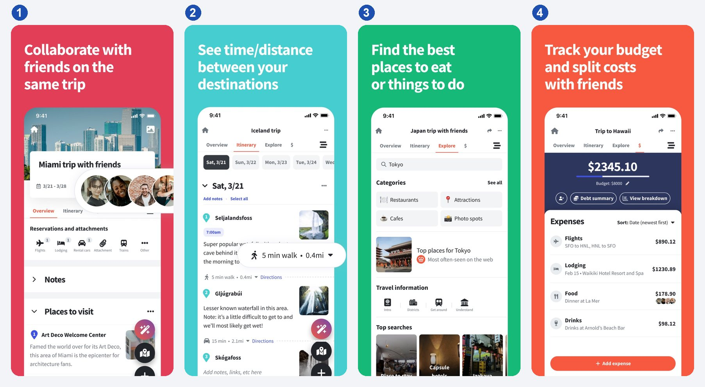

1 Trip with companions · 2 Day-by-day itinerary · 3 Explore: where to eat · 4 Budget and cost split

### TripIt

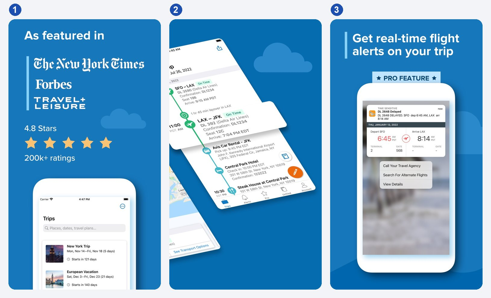

1 Trip list · 2 Itinerary as a timeline · 3 Real-time alert (Pro)

## Group decisions and polls

| | WhatsApp and iMessage | Howbout | Partiful |
| --- | --- | --- | --- |
| Does well | Poll right in the chat, zero friction; iMessage: avatars on options, anyone can add an option; WhatsApp 2026: end time and hidden votes | Plan = details + chat + poll in one place; notifications say exactly what changed | Link works without the app; “Find a Time” votes turn into RSVPs; a feed instead of a chat |
| Falls short | Options are plain text; the result sinks in the chat and never reaches a plan; iMessage leaves out Android | Time and calendar only, not places; no multi-day trip, no expenses | Polls only for dates; late invitees don’t see them; one event, not a trip |
| For TripUp | Take the avatars and the filled leading option; add place cards and a deadline | Tie the poll to a plan slot (“Dinner, Sat 20:00”) | Ren votes from the browser; a new member sees open polls |

### What users say

| App | Users complain | Users like |
| --- | --- | --- |
| WhatsApp polls | Some members never get the poll, vote counts look wrong ([r/whatsapp](https://www.reddit.com/r/whatsapp/comments/1wdcnxv/)); no date poll, typing dates is tedious ([r/whatsapp](https://www.reddit.com/r/whatsapp/comments/1ox08e2/)); can’t add votes for friends who won’t use the app ([r/whatsapp](https://www.reddit.com/r/whatsapp/comments/1mt3ph6/)) | Groups use it for RSVPs; seeing who viewed but didn’t vote was a “killer feature” ([r/whatsapp](https://www.reddit.com/r/whatsapp/comments/1rge6a6/)) |
| iMessage polls | Android or older-iOS members can’t vote ([MacRumors](https://forums.macrumors.com/threads/ios-26-create-polls-in-the-messages-app.2467201/), [Apple Community](https://discussions.apple.com/thread/256149974)); polls missing for some members ([r/ios](https://www.reddit.com/r/ios/comments/1nipqeb/)); half-baked, no anonymous option ([r/ios](https://www.reddit.com/r/ios/comments/1nnp36v/)) | Easy group decisions in all-Apple groups and families ([r/ios](https://www.reddit.com/r/ios/comments/1q4x3ws/)) |
| Howbout | Sep–Oct 2026 update put color coding behind Howbout+; app locked until invited friends sign up ([App Store](https://apps.apple.com/us/app/id1477248221?see-all=reviews)) | Seeing friends’ free days makes planning easy ([App Store](https://apps.apple.com/us/app/id1477248221?see-all=reviews)) |
| Partiful | Guests must give a phone number and SMS code to RSVP; reminders come from an unknown number that looks like spam ([App Store](https://apps.apple.com/us/app/id1662982304?see-all=reviews)) | Text blasts, RSVP tracking and reminders, all free ([App Store](https://apps.apple.com/us/app/id1662982304?see-all=reviews)); lighter than Facebook events ([Hacker News](https://news.ycombinator.com/item?id=48884285)) |

### WhatsApp and iMessage polls

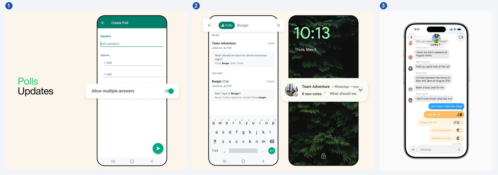

1 WhatsApp: create, single or multiple answers · 2 WhatsApp: “8 new votes” grouped · 3 iMessage: leading option filled, voter avatars

### Howbout

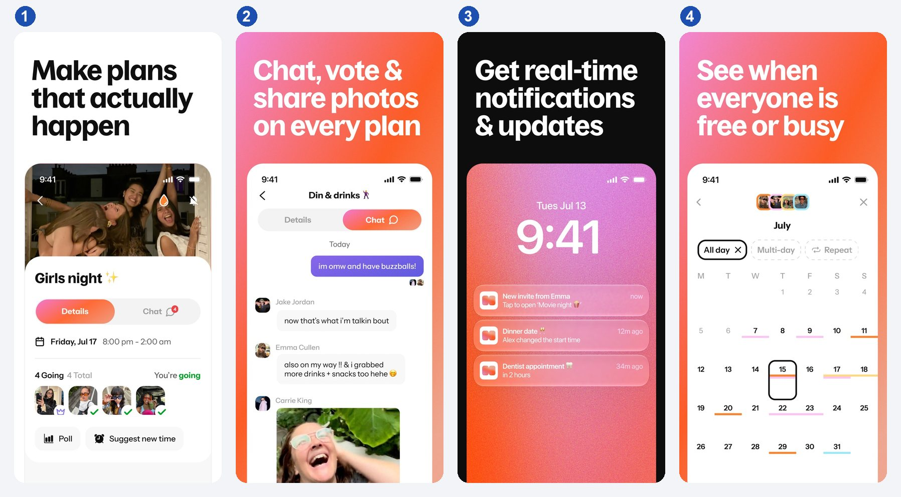

1 Plan: who’s going, Poll, Suggest new time · 2 Chat inside the plan · 3 Change notifications · 4 Group availability

### Partiful

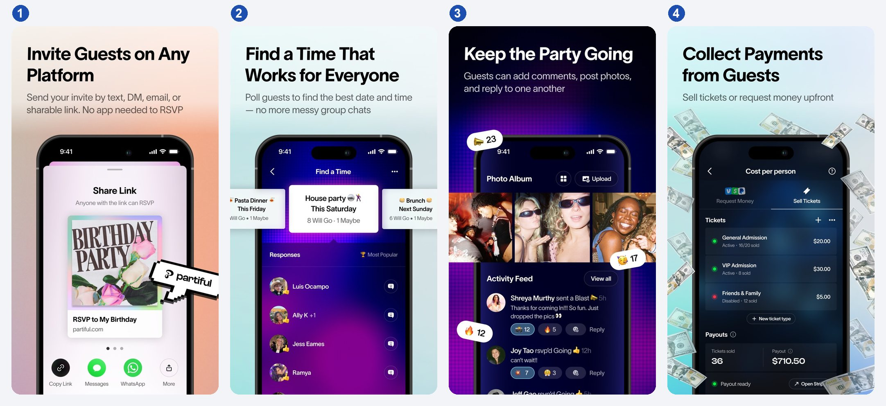

1 Invite by link, RSVP without the app · 2 “Find a Time” with “Most Popular” · 3 Activity feed · 4 Cost per person and payments

## Expenses and settling up

| | Splitwise | Tricount | Settle Up | Splid | Tab |
| --- | --- | --- | --- | --- | --- |
| Does well | Every split type; simplify debts; Itemize (Oct 2026, US/UK): snap the receipt, everyone claims their items | Free, no ads, no limits; checkbox and 2x/1x/0x; offline | “Minimize debts” toggle; reminders to debtors; per-trip pass | No sign-up; 150+ currencies for free; one “Settle Up” button | Snap the receipt, everyone taps what they ordered; tax and tip split proportionally |
| Falls short | Free tier: 4 expenses a day plus ads; payments only in the US and parts of the EU | No item-level split; simplification confuses (there’s an FAQ for it); payment links in 4 countries | Can’t exclude someone from one item; payments only via Czech banks; dated look | No in-app payments; no item-level split | One bill only, no balances across the trip |
| For TripUp | Balance hierarchy; never cap expense entry | Checkbox pattern for excluding | Simplification on by default | Guests without an account | Item × people without mandatory scanning |

### What users say

| App | Users complain | Users like |
| --- | --- | --- |
| Splitwise | Daily expense cap and 10-second waits block people mid-trip ([App Store](https://apps.apple.com/us/app/id458023433?see-all=reviews), [r/travel](https://www.reddit.com/r/travel/comments/1s143e4/comment/oby3s94/)); Splitwise Pay holds money for weeks or never arrives ([Trustpilot](https://www.trustpilot.com/review/splitwise.com)); can’t mute promo notifications without losing useful ones ([App Store](https://apps.apple.com/us/app/id458023433?see-all=reviews)) | Simplify debts removes back-and-forth transfers ([r/travel](https://www.reddit.com/r/travel/comments/1twlav8/comment/opp4io4/)); log receipts during the trip, pay once at the end ([r/travel](https://www.reddit.com/r/travel/comments/1twlav8/comment/opp2e95/)) |
| Tricount | Balances look wrong, users re-check in spreadsheets ([Trustpilot](https://www.trustpilot.com/review/tricount.com)); an update removed the per-person view, so you can’t tell what a debt is for; optimized repayments can’t be turned off ([App Store](https://apps.apple.com/us/app/id349866256?see-all=reviews)) | Free, no ads, no limits: where people go when they leave Splitwise ([r/travel](https://www.reddit.com/r/travel/comments/1s143e4/comment/oby6c3x/), [r/androidapps](https://www.reddit.com/r/androidapps/comments/17prad3/comment/na2ugja/)); add as you go, no math ([r/travel](https://www.reddit.com/r/travel/comments/1kbkz70/comment/nbzt4xe/)) |
| Settle Up | Unskippable ads; free version showed only net totals, not who owes whom; invites failed silently ([App Store](https://apps.apple.com/us/app/id737534985?see-all=reviews)) | One person runs it, others view by link without the app; weighted shares for couples ([Google Play](https://play.google.com/store/apps/details?id=cz.destil.settleup&hl=en_US)) |
| Splid | Free version allows one group, not clear before install; suggested settlement didn’t match a spreadsheet; no receipt photos ([App Store](https://apps.apple.com/us/app/id991473495?see-all=reviews)) | Easy, multi-currency, works offline ([App Store](https://apps.apple.com/us/app/id991473495?see-all=reviews)); no sign-up ([Hacker News](https://news.ycombinator.com/item?id=34819340)) |
| Tab | Scanning misses items on big bills; Venmo link never connects; bills auto-delete while people are still paying ([App Store](https://apps.apple.com/us/app/id595068606?see-all=reviews)) | Splits a dinner by item when people ordered differently ([r/travel](https://www.reddit.com/r/travel/comments/1s143e4/comment/obyfcps/)) |

### Splitwise

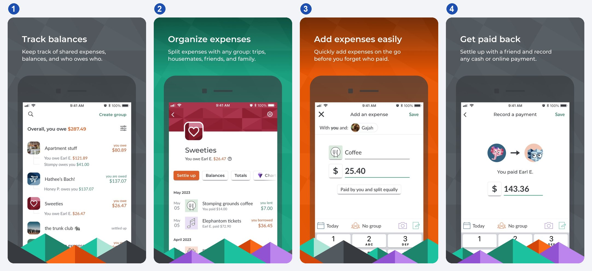

1 Overall balance by group · 2 Group: Settle up, Balances, Totals · 3 Add expense: “Paid by you and split equally” · 4 Record a payment, manual

### Tricount

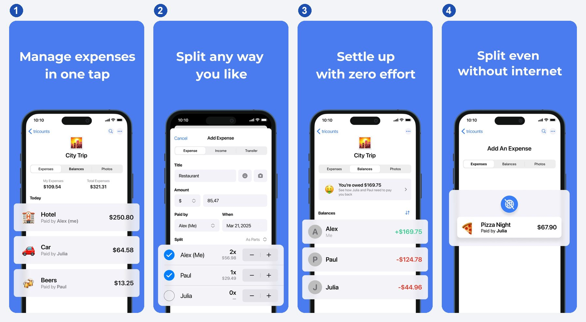

1 Trip: Expenses, Balances, Photos · 2 “As parts”: checkbox and 2x/1x/0x · 3 Balances with an explanation · 4 Offline entry

### Settle Up

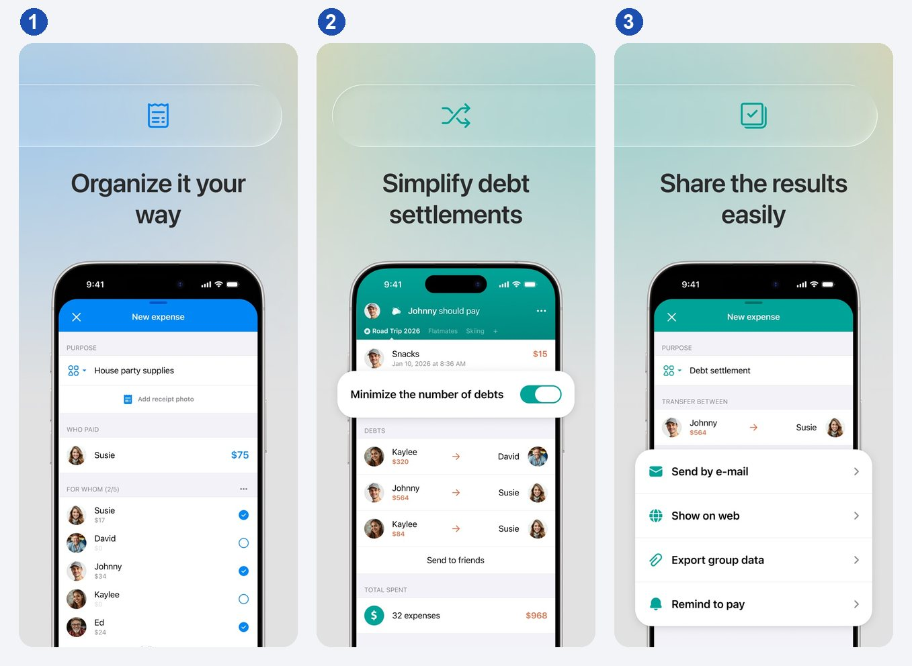

1 New expense: “For whom” checkboxes · 2 Minimize the number of debts: who pays whom · 3 Payment reminder

### Splid

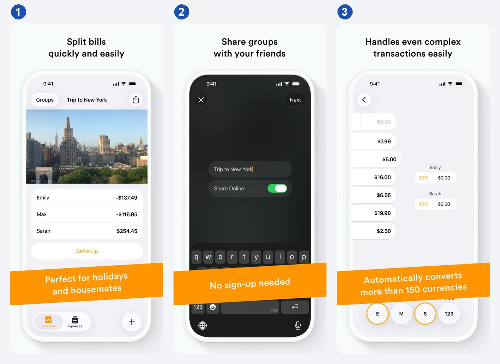

1 Balances and Settle Up · 2 Sharing without sign-up · 3 Percentages and currencies

### Tab

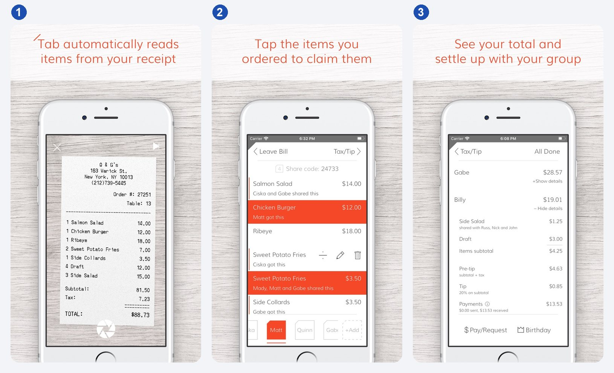

1 Receipt scan · 2 Tap the items you ordered · 3 Total per person, Pay / Request

## Payments and “squared up”

| | Venmo Groups | Revolut | bunq + Tricount, Splitwise Pay by Bank |
| --- | --- | --- | --- |
| Does well | Money actually moves; “Pay” button at the top of the feed; “all paid up” message once everyone has paid | Instant and free between Revolut users; others get a payment link | Bank links (iDEAL, Bancontact, Sofort); Pay by Bank in the UK, DE and AT |
| Falls short | US and dollars only; everyone needs Venmo; whoever logs the expense counts as the payer | Equal or exact amounts only; the link for non-users expires in 7 days | 3–4 countries each; cards cost 2.5%; no cross-currency payments |
| For TripUp | One tap with the amount prefilled; “squared up” as a group event | Non-users pay from a link | One “Pay” button picks the rail for each pair |

### What users say

| App | Users complain | Users like |
| --- | --- | --- |
| Venmo Groups | No partial payments, you pay the whole group debt at once ([r/venmo](https://www.reddit.com/r/venmo/comments/1dqh1bh/)); balance glitches, wrong payee, “marked as paid” can’t be undone ([r/venmo](https://www.reddit.com/r/venmo/comments/1gkfou3/)); a member rejoined under another account and ~$800 went unpaid ([r/venmo](https://www.reddit.com/r/venmo/comments/1wiziej/)) | “Works a lot like Splitwise”; a trip group switched after years on Splitwise ([r/travel](https://www.reddit.com/r/travel/comments/1s143e4/comment/oby5b5v/)) |
| Revolut | Split bill stopped working with friends not on Revolut ([r/Revolut](https://www.reddit.com/r/Revolut/comments/1h90ori/)); exchange fees aren’t split, the payer absorbs them ([r/Revolut](https://www.reddit.com/r/Revolut/comments/1hepylc/)); suggests random old contacts instead of your group ([r/Revolut](https://www.reddit.com/r/Revolut/comments/1uio80i/)) | Easy when the whole group is on Revolut ([r/travel](https://www.reddit.com/r/travel/comments/1twlav8/comment/oppbky4/), [r/Revolut](https://www.reddit.com/r/Revolut/comments/1nkj2v7/)) |

### Venmo Groups

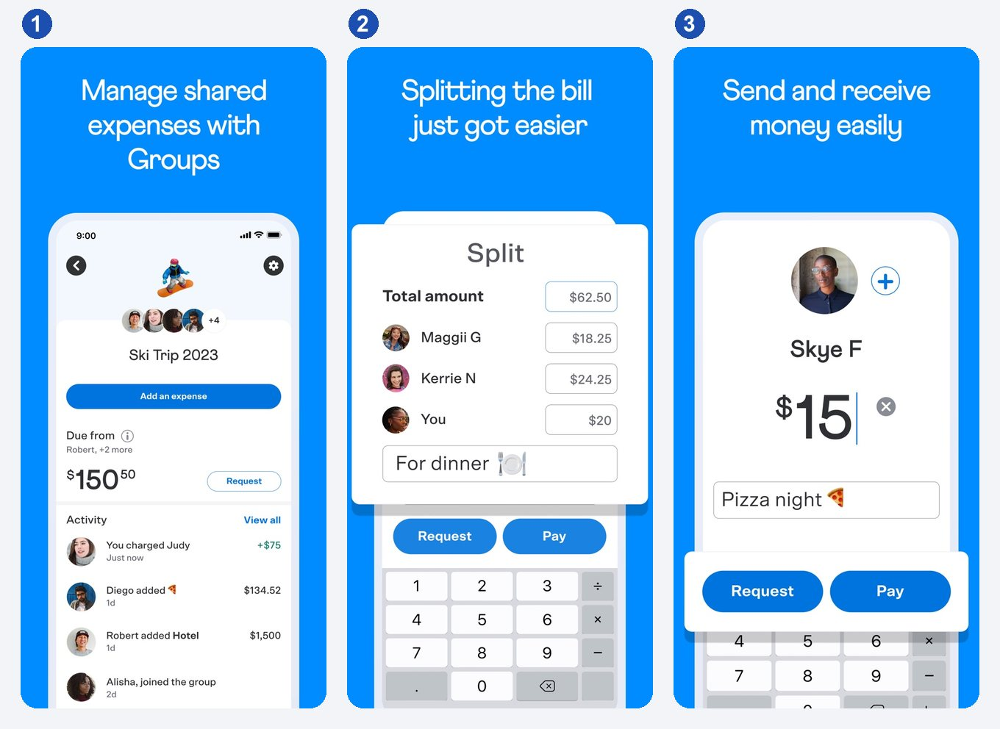

1 Groups: “Due from” and Request, group feed · 2 Split: amount per person · 3 Request / Pay

The Revolut and bunq App Store screens don’t show bill splitting, so they aren’t shown here.

## Payments under the hood

TripUp never holds the money. EU open banking (PSD2) gives it two ways to know that Nic paid Ari.

| | Nic pays from TripUp (payment initiation, PIS) | Ari connects her account (account information, AIS) |
| --- | --- | --- |
| Who gives access | Nic, for this one payment | Ari, read-only access to her transactions |
| How TripUp knows | It started the payment; the bank returns a status | It reads Ari’s incoming payments and matches them to debts |
| Speed | Seconds with SEPA Instant | Minutes to hours |
| Reliability | Exact | Exact with a reference code, weak on name alone |
| Seen in | Splitwise Pay by Bank (Tink), Tricount request links | Accounting apps with bank feeds |

**Payment initiation flow**

1. Nic taps “Pay €24”. Through a licensed provider (Tink, TrueLayer), TripUp creates the transfer: Nic’s account → Ari’s IBAN, €24, reference `TRIPUP-7F3K`.
2. Nic approves it in his bank app with Face ID.
3. The bank sends the money and reports the status back to TripUp. The debt closes and Ari is notified.

**Account information flow**

1. Every SEPA transfer carries the payer’s name and IBAN, the amount, a description of up to 140 characters and a payment ID.
2. TripUp sees “€24 from Nic Stout, TRIPUP-7F3K” on Ari’s statement and closes the matching debt.
3. With no reference it matches on amount, name and date, then asks Ari: “Looks like Nic paid €24. Confirm?”

**Limits:** without the user present, an app may read the account at most [4 times a day](https://eur-lex.europa.eu/legal-content/EN/TXT/?uri=CELEX:32018R0389) (Art. 36(5)); access must be re-approved every [180 days](https://lawplayer.com/eu/act/32022R2360); Ari would expose her whole statement to a travel app.

**For TripUp:** payment initiation as the main flow; “Mark as paid” plus payee confirmation for payments made outside the app; account matching optional. Design the states Pending → Paid → Confirmed. Serbia has no PSD2 open banking; the [NBS IPS QR code](https://ips.nbs.rs/en/) moves money in seconds but sends no confirmation back to the app.

## Design direction

The brief asks you to spot when competitors got it right, when to improve on them, and when to take another approach.

| Pattern | Reference | Decision |
| --- | --- | --- |
| Balance hierarchy: overall → group → item | Splitwise, Tricount | Adopt |
| Checkbox and 2x / 1x / 0x when adding an expense | Tricount | Adopt |
| Voter avatars and a filled leading option | iMessage | Adopt |
| Day timeline with map and walking minutes | Wanderlog, TripIt | Adopt |
| Join by link without an account | Partiful, Splid | Adopt |
| Currency per expense, offline entry | Tricount, Splid | Adopt |
| Poll option as a place card (photo, rating, price, walk) | Telegram, location only | Improve |
| Deadline plus a “Leading” chip with the vote margin | WhatsApp, Telegram, deadline only | Improve |
| Exclude someone from an item without scanning a receipt | Splitwise Itemize, Tab | Improve |
| “6 → 2 transfers” with an explanation | Settle Up, Tricount | Improve |
| Notifications by role: participants get 2 pushes, the organizer a digest | WhatsApp grouping | Improve |
| Poll winner goes into the itinerary by itself, with undo | nobody | Do differently |
| Late joiner sees open polls and a recap, no past expenses | nobody | Do differently |
| One “Pay” button, the debt closes itself | Venmo, US only | Do differently |
| “Squared up” card and push to the whole group | nobody | Do differently |
| Per-trip pricing, no cap on logging expenses | Settle Up pass | Do differently |

## Sources

Ratings: Apple iTunes API, 20 Oct 2026. Screens: App Store marketing screenshots; WhatsApp from Meta Newsroom; iMessage from Apple press materials.

- **Polls:** [WhatsApp 2023](https://blog.whatsapp.com/new-updates-to-polls-and-sharing-with-captions-on-whatsapp) · [WhatsApp Aug 2026](https://blog.whatsapp.com/your-group-chats-upgraded-introducing-better-polls-all-and-more) · [Apple Messages](https://support.apple.com/guide/iphone/poll-people-in-a-conversation-iphde1787df4/ios) · [Telegram Mar 2026](https://telegram.org/blog/ai-editor-mighty-polls-and-more/) · [Partiful Find a Time](https://help.partiful.com/en-us/articles/15525423-using-find-a-time-to-poll-guests-on-date-and-time) · [Doodle Book it](https://help.doodle.com/en/articles/9457340-how-do-i-send-out-a-calendar-invitation-to-my-booked-group-poll)
- **Planning:** [Wanderlog](https://apps.apple.com/us/app/wanderlog/id1476732439) · [TripIt roles](https://help.tripit.com/en/support/solutions/articles/103000063367-trip-sharing-from-our-website) · [Lambus invites](https://support.lambus.com/en/article/how-can-i-invite-fellow-travelers) · [Troupe shut down](https://www.getlimbo.app/blog/troupe-app-shut-down-alternatives) (competitor’s site) · [Truce](https://truceapp.com/)
- **Expenses:** [Splitwise Itemize](https://www.prnewswire.com/news-releases/splitwise-launches-new-feature-that-takes-the-awkwardness-out-of-splitting-the-check-302907809.html) · [Splitwise simplify debts](https://kb.splitwise.com/balances-and-expenses/what-is-simplify-debts) · [Splitwise daily limit](https://feedback.splitwise.com/knowledgebase/articles/2010350-why-am-i-seeing-an-expense-limit) · [Tricount FAQ](https://help.tricount.com/articles/tricount-faqs) · [Tricount request links](https://help.tricount.com/articles/tricount-request-links) · [Settle Up](https://settleup.io) · [Splid](https://splid.app/english)
- **Payments:** [Venmo Groups](https://newsroom.paypal-corp.com/2023-11-14-Introducing-Venmo-Groups) · [Venmo “all paid up”](https://help.venmo.com/cs/articles/settling-up-group-expenses-vhel192) · [Revolut Group Bills](https://www.finextra.com/pressarticle/83753/revolut-introdcues-group-bills) · [Splitwise Pay by Bank](https://tink.com/press/splitwise-tink-partner/)
